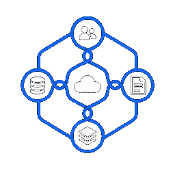
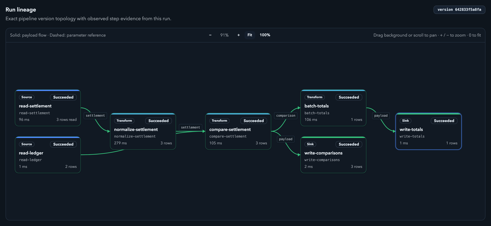

<p align="center">
  
</p>

# Braidplane Community core

**Connect systems, transform data, and run pipelines versioned in Git.**

Braidplane is an open-source data integration platform for developers and data
teams who need to move and combine data across databases, APIs, CRMs and file
stores. For example, join order records with customer data and write the result
to S3. Work through the web interface, CLI or API.

[How it works](docs-public/getting-started/overview.md) ·
[Run locally](#run-locally) ·
[Pipeline examples](docs-public/examples/index.md) ·
[Connector capabilities](docs-public/connectors/index.md)

[](docs-public/getting-started/images/product-run-lineage.png)

*Run lineage with synthetic data: settlement file + payment ledger → comparison
rows and totals. Inspect the executed pipeline version, step status, timing and
row counts. Click the image for a full-size view.*

[Explore pipeline examples](docs-public/examples/index.md) ·
[How runs work](docs-public/getting-started/overview.md#5-run-and-inspect)

## What you can do

- **Connect your systems.** Configure connections to PostgreSQL, MySQL, MongoDB,
  HTTP, HubSpot, S3 and other supported systems.
- **Review pipeline changes in Git.** Keep definitions versioned, with credentials
  stored separately in configured connections.
- **Use different connections per environment.** Bind a definition's logical
  connection names to a project's saved data sources.
- **Validate, deploy and inspect.** Check the definition, deploy an immutable
  version, then inspect run status, step timelines and failure diagnostics.
- **Assess changes with Proof.** Inspect claims and evidence for an exact Git
  change and target before deciding whether to apply it.

Braidplane and its connectors are **Alpha**. Use synthetic test data; connector
operations and limits vary. See the [connector guide](docs-public/connectors/index.md)
for capabilities and support levels.

## Community edition

This repository contains the Community backend, frontend, CLI, API schema and
core migrations.
Read [how Braidplane works](docs-public/getting-started/overview.md) for a tour,
or explore [pipeline examples](docs-public/examples/index.md).

Community includes Proof and the existing authentication, authorization and
diagnostics. It has no pipeline-count, usage or trial restrictions.
Technical resource safeguards still apply; operators configure them through
[CONFIG.md](CONFIG.md).

## Run locally

From a checkout of this repository, install Bash, Git, Python 3, OpenSSL, Go,
[Task](https://taskfile.dev/) and Docker with Compose. Start Docker, then run:

```sh
task dev
```

The first run downloads the pinned toolchains and dependencies, builds the
application, starts PostgreSQL and Mailpit, and applies core migrations. Open
<http://127.0.0.1:3002>, create an account and find its verification email at
<http://127.0.0.1:38025>. Provider credentials are only needed for integrations
that use them.

Ctrl-C stops the application processes; the database, Mailpit and local keys
remain for the next run. Keep the keys with the database: encrypted data needs
the original keys. See [local setup](COMMUNITY_BUILD.md#run-locally) for ports,
stopping containers and running multiple instances. To grant administrator
access, follow [instance administrators](doc/INSTANCE_ADMIN.md).

This is a developer setup, not a qualified production installation. No supported
release/platform matrix is declared yet. Follow [support and maintenance](SUPPORT.md)
for current limits and [Alpha compatibility](docs-public/api/alpha.md) before upgrades.

For a complete synthetic workflow, follow [PostgreSQL to S3](docs-public/getting-started/first-pipeline.md).
It lists the separate database, bucket and Git prerequisites, downloadable inputs,
expected results and cleanup. Runtime qualification of the selected distribution
remains required; local startup alone does not prove that workflow.

## Common questions

### Is AI used to develop Core?

Yes. AI tools are used during development, testing and review. The maintainer
decides which changes are accepted and remains responsible for the project.

### Can I use AI tools when contributing?

Yes. You remain responsible for the changes you submit. See
[AI-assisted contributions](CONTRIBUTING.md#ai-assisted-contributions) for
disclosure, testing and reporting requirements.

## Help and participation

Use [GitHub Issues](https://github.com/Braidplane/braidplane-core/issues/new/choose)
for bugs and proposals, [support guidance](SUPPORT.md) for maintenance and conduct,
and [SECURITY.md](SECURITY.md) for private vulnerability reports.
Read [CHANGELOG.md](CHANGELOG.md) for changes and the
[contribution guide](CONTRIBUTING.md) before submitting work.

## Develop

Use [build and validation](COMMUNITY_BUILD.md) for toolchain, test, generation
and container instructions. [Contributing](CONTRIBUTING.md) and
[quality gates](doc/QUALITY_GATES.md) describe checks for changes;
[engineering documentation](doc/index.md), [configuration](CONFIG.md) and
[package boundaries](doc/PACKAGE_BOUNDARIES.md)
cover runtime settings and code ownership.

## License

First-party code and technical documentation use [Apache-2.0](LICENSE).
Third-party files retain their own licenses; see [NOTICE](NOTICE).
The [release rights inventory](doc/RELEASE_RIGHTS.md) describes the covered
material, notice delivery and remaining distribution checks.
