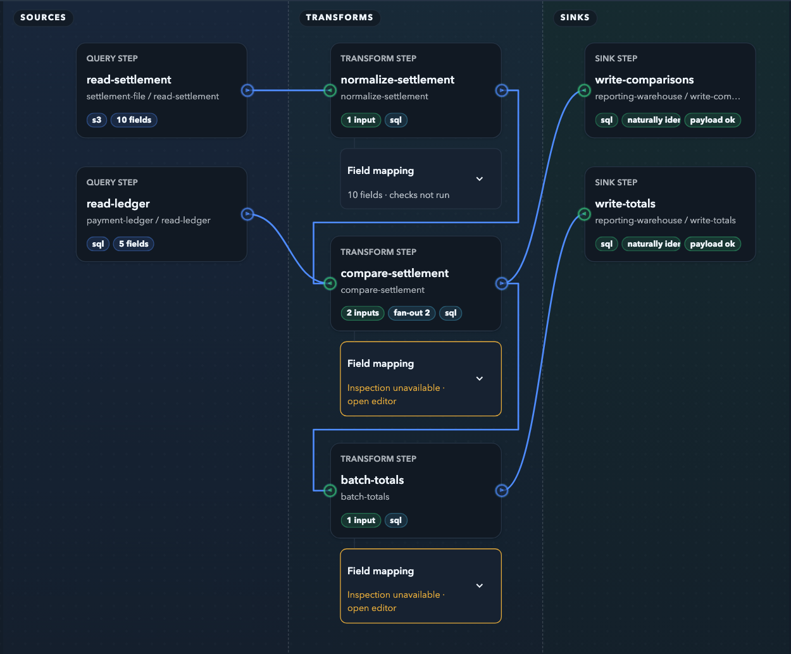
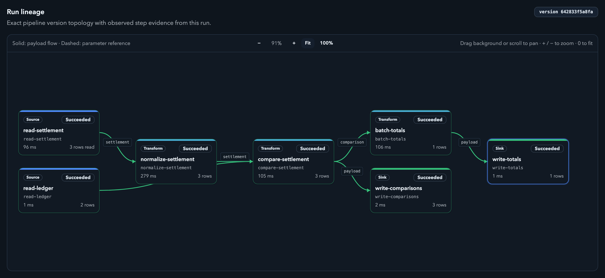

<p align="center">
  
</p>

# Braidplane Community core

[](https://github.com/Braidplane/braidplane-core/actions/workflows/ci.yml)
[](LICENSE)
[](docs-public/getting-started/overview.md)

**Braidplane is a declarative, contract-based data integration platform.**

Define ETL pipelines in Git, specify data contracts between steps, and inspect
the exact version and results of each run. Braidplane is open source and built
for developers and data teams who move and combine data across databases, APIs,
CRMs and file stores. For example, join order records with customer data and
write the result to S3. Work through the web interface, CLI or API.

**[Get your first result in the UI](docs-public/getting-started/first-result.md).**
Connect one supported data source, save a query and run it before setting up a
pipeline or Git repository. You’ll need a Braidplane account with permission to
add a data source, save a query and run it. You’ll also need credentials for a
source your instance can reach. If you need an instance, [run Community Core
locally](#run-locally) and create a local account.

You can [explore the settlement example below](#settlement-example) without an
account or data source. The screenshots show the pipeline and its completed run
with sample data.

Community Core is in Alpha. See the [latest non-prerelease on GitHub](https://github.com/Braidplane/braidplane-core/releases/latest).
Tags ending in `-rc.N` are release candidates. The
[Core stability guide](docs-public/core-stability.md) describes what was
verified for v0.2.0 and what remains for v1.0.

[How it works](docs-public/getting-started/overview.md) ·
[Run locally](#run-locally) ·
[Pipeline examples](docs-public/examples/index.md) ·
[Connector capabilities](docs-public/connectors/index.md)

## Settlement example

[](docs-public/getting-started/images/product-pipeline-builder.png)

*This pipeline checks a settlement file against a payment ledger. Follow the
lines from `compare-settlement` to see where the individual comparisons and
the batch totals go.*

[](docs-public/getting-started/images/product-run-lineage.png)

*Here’s the same pipeline after a run with sample data. It wrote three
comparison rows and one row of batch totals. Click either image to zoom in.*

[Explore pipeline examples](docs-public/examples/index.md) ·
[How runs work](docs-public/getting-started/overview.md#5-run-and-inspect)

## What you can do

- Connect PostgreSQL, MySQL, MongoDB, HTTP APIs, HubSpot, S3 and other
  available systems.
- Review pipeline changes in Git, with credentials stored separately in
  configured connections.
- Use different connections per environment. Bind a definition's logical
  connection names to a project's saved data sources.
- Validate the definition, deploy an immutable version, then inspect run status,
  step timelines and failure diagnostics.
- Assess changes with Proof. Inspect claims and evidence for an exact Git
  change and target before deciding whether to apply it.

See the [connector guide](docs-public/connectors/index.md) for available operations,
connection settings and examples.

## Community edition

Community includes the backend, web interface, CLI, API schema, core migrations,
Proof, authentication, authorization and run diagnostics. There are no
pipeline-count, usage or trial restrictions. Configure runtime resource limits
through [CONFIG.md](CONFIG.md).

## Run locally

From a checkout of this repository, install Bash, Git, Python 3, OpenSSL, Go,
[Task](https://taskfile.dev/) and Docker with Compose. Start Docker, then run:

```sh
task dev
```

The first run downloads the pinned toolchains and dependencies, builds the
application, starts PostgreSQL and Mailpit, and applies core migrations. Open
<http://127.0.0.1:3002>, create an account and find its verification email at
<http://127.0.0.1:38025>. Open the link and select **Verify email**. Provider
credentials are only needed for integrations that use them.

Ctrl-C stops the application processes; the database, Mailpit and local keys
remain for the next run. Keep the keys with the database: encrypted data needs
the original keys. See [local setup](COMMUNITY_BUILD.md#run-locally) for ports,
stopping containers and running multiple instances. To grant administrator
access, follow [instance administrators](doc/INSTANCE_ADMIN.md).

Build your first pipeline with the [PostgreSQL to S3 walkthrough](docs-public/getting-started/first-pipeline.md).
It includes sample data, a pipeline definition, expected results and cleanup
commands. You will need a database, an S3 bucket and a Git repository.

Core v0.2.0 ran a verified pipeline on 2 vCPUs, 4 GiB RAM and a 20 GiB disk.
See the [self-hosted footprint comparison](comparison/small-host.md) for measured
RAM, disk, upgrade space and results for Airflow, Airbyte and Kestra.

## Common questions

### Is AI used to develop Core?

Yes. AI tools are used during development, testing and review. The maintainer
decides which changes are accepted and remains responsible for the project.

### Can I use AI tools when contributing?

Yes. You remain responsible for the changes you submit. See
[AI-assisted contributions](CONTRIBUTING.md#ai-assisted-contributions) for
disclosure, testing and reporting requirements.

## Help and participation

Use [GitHub Issues](https://github.com/Braidplane/braidplane-core/issues/new/choose)
for bugs and proposals, [support guidance](SUPPORT.md) for maintenance and conduct,
and [SECURITY.md](SECURITY.md) for private vulnerability reports.
Read [CHANGELOG.md](CHANGELOG.md) for changes and the
[contribution guide](CONTRIBUTING.md) before submitting work.

## Develop

Use [build and validation](COMMUNITY_BUILD.md) for toolchain, test, generation
and container instructions. [Contributing](CONTRIBUTING.md) and
[quality gates](doc/QUALITY_GATES.md) describe checks for changes;
[engineering documentation](doc/index.md), [configuration](CONFIG.md) and
[package boundaries](doc/PACKAGE_BOUNDARIES.md)
cover runtime settings and code ownership.

## License

First-party code and technical documentation use [Apache-2.0](LICENSE).
Third-party files retain their own licenses; see [NOTICE](NOTICE).
See the [release rights inventory](doc/RELEASE_RIGHTS.md) for third-party components
and notice requirements.
