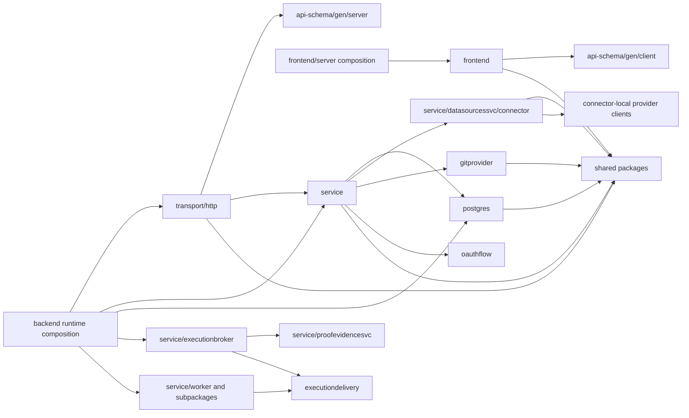

# Package Boundaries

This document defines the intended Go package dependency graph for the main
Braidplane application layers. The import restrictions below are enforced by `depguard` in `.golangci.yml`.
`task lint` and CI `task ci` also exercise compile-valid allowed/forbidden
fixtures with the pinned linter; a clean application lint alone is not proof
that selectors match.

## Core module and CLI

The product uses one `github.com/Braidplane/braidplane-core` Go module. The CLI
command lives under `cli/`; reusable pipeline contracts, connector metadata,
slugs and error helpers live in packages under `pkg/`. Consumers can import these
packages directly. Depguard prevents shared and backend packages from importing
the CLI implementation.

`pkg/model` holds pipeline contract types. `pkg/domain/model` holds backend domain types
and aliases the shared pipeline types. Pipeline validation tags are registered in
`pkg/structvalidate`; backend-specific tags remain in `pkg/validate`.

## Core composition and extension contracts

`backend` owns the shared service graph and API, worker and executor lifecycles.
The root command loads core configuration and supplies Community policy without
commercial caps. The required `DistributionFactory` supplies operation admission
and run adapters, repository preparation, and HTTP/command extensions. Missing
required policy fails closed. Core never imports a consumer distribution's
implementation, configuration or private API bindings.

`service/admissionsvc` defines the Community admission contract and checks that
the tenant exists. Distributions supply their own admission adapters and own
commercial entitlement storage, enforcement, diagnostics and presentation. Core
has no commercial plan policy, trial lifecycle or entitlement schema. Its runtime
packages still own technical execution budgets and connector limits.

The HTTP server owns protected request authorization and receives an explicit
member-admission policy. The execution broker owns the required operation-
admission interface; blocked connection tests preserve data-source health.
Runtime persistence adapters are explicit constructor inputs.

Account creation, invitation acceptance and deletion support optional service
callbacks inside their existing transactions. A callback failure rolls back the
operation. Invitation callbacks also run on accepted-invitation retries.
Frontend presentation extensions can supply account-form components and a
context-bound API request editor. Core owns authentication, CSRF protection and
request forwarding around these extensions.

`frontend.Router` and `CommunityPresentation` own the Community frontend.
Presentation extensions receive only the shell, permissions, request forwarding,
rendering and safe-login-redirect facade; they cannot access sessions or
authentication services directly. Core includes no hosted marketing or private
administration implementation. Consumer-specific services, assets and worker
commands belong in their own repository.

## Import Graph

The application keeps a flat layered shape:

Allowed direction:

| Package area | Responsibility | May import |
|---|---|---|
| `main.go` | Backend API process wiring | Backend config, `transport/http`, `service/*`, `postgres/*`, generated API server types, and shared packages needed to compose the backend process |
| `backend` | Reusable core backend composition | Backend configuration, services, persistence and shared packages; no frontend code |
| `cmd/frontend` | Standalone SSR frontend process wiring | Frontend config, `frontend`, generated API client types, and process-shared packages needed for logging, metrics, tracing, request context, sessions, and proxy behavior |
| Other `cmd/*`, `pkg/fake` | CLI entrypoints and fake data setup | Any application layer needed to compose the specific tool |
| `transport/http` | Backend HTTP request parsing, response mapping, auth/session adapter behavior, and permission checks before protected service calls | `service/*`, shared packages, generated API server types |
| `frontend` | SSR frontend server, Templ rendering, HTMX flows, backend API client calls | `api-schema/gen/client`, `frontend/views`, shared runtime-neutral packages |
| `service` | Business logic, validation, orchestration, and the shared authorization engine package consumed by HTTP handlers | `postgres/*`, connector packages, shared packages |
| `service/pipelinetriggersvc` | Completion resource validation and immutable closure snapshot admission; re-evaluates captured and current permission facts through the shared authorization policy, with persistence locks fencing revocation. HTTP continues to use `authorization.Service.Can`. | `postgres/*`, `service/authorization`, shared packages; no provider or queue dispatch |
| `service/proofconfigsvc` | Data-source-owned Proof controls and explicit project/environment assessment targets | `postgres/proofconfig`, `datasourcessvc` repository access verification and webhook setup, and required audit production; HTTP owns permission checks and provider identity is derived from the data source |
| `service/executionbroker` | Backend-neutral persisted execution submission and processing contracts | `postgres/*`, connector packages, `proofevidencesvc` restricted execution contracts, shared packages; never `service/worker` or its subpackages |
| `service/filetransfersvc` | Encrypt, seal and verify retained byte streams under live execution claims | `postgres/retainedfiles` through the repository interface, transaction management and shared byte/file contracts; providers remain in connector adapters |
| `service/proofevidencesvc` | Grant-bound selected-resource observations, restricted HTTP/native metadata transport, and backend durable-ledger orchestration and keyless retention | `pkg/proofevidence`, shared host guard, grant-scoped `credentialssvc` reads/checks, and `postgres/proofobservations`, plus `eventrecorder` for atomic lifecycle/retention audits; connector-owned observers implement the neutral metadata contract. Connector observers own fixed native or HTTPS metadata reads under admitted public I/O; see Proof coverage. No provider clients, unrestricted connector operations, Git provider, pipeline runtime, or receipt-read authority. The backend coordinator uses an execution interface implemented by `executionbroker`; the broker constructs trusted connector observers for dispatch, while admission and receipt evaluation reconstruct their plans without provider calls. Executors receive the encrypted operation and return protected metadata, with no ledger or credential-store capability. Bounded backend health callbacks expose only deployment aggregate counts/timestamps to neutral metric collectors, without granting the executor database access. |
| `service/notificationsvc/provider` | Notification delivery provider adapters and safe delivery error classification | Shared provider clients in shared packages and organization-scoped credential resolution; no pipeline data-source prerequisite. `notificationsvc` owns policy routing and durable attempt orchestration. |
| `service/worker`, `service/worker/producer`, `service/worker/consumer` | River worker host and queue adapters | Other allowed service dependencies and shared packages; `backend/runtime.go` composes worker adapters with `service/executionbroker` through `pkg/executiondelivery` |
| `postgres` | Persistence, SQLC-backed repositories, transaction boundaries, DB error mapping | `postgres/dbgen`, shared packages |
| `service/datasourcessvc/connector` | Braidplane connector adapters, connector-local provider clients, and normalized connector capabilities | Connector sibling packages, connector-local client packages, and shared packages |
| `pkg/gitprovider` | GitHub/GitLab provider API clients, authenticated change adapters, and provider-neutral proposal/change metadata used by Git-authored pipeline publish, refresh, and Proof ingestion | Shared packages and third-party provider SDKs |
| `pkg/proofevidence` | Runtime-neutral Proof evidence request, authorization, operation, egress, runner-trust, retention, and budget admission contract | Standard library plus `pkg/hostguard`, `pkg/domain/model`, `pkg/slug`, and `pkg/xerror`; never connector clients, Git-provider clients, credentials, persistence, worker queues, or receipt transport |
| `pkg/oauthflow` | Runtime-neutral OAuth helper plumbing such as authorization URLs, state generation/hashing/expiry, token exchange helpers, refresh/revoke request helpers, and safe provider error mapping | Shared packages and OAuth libraries |
| Shared packages | Shared technical helpers and cross-layer value utilities | Standard library, third-party utilities, and explicitly documented Braidplane exceptions |

Forbidden direction:

| From | Must not import | Reason |
|---|---|---|
| `main.go` | `frontend`, `config/frontend`, `api-schema/gen/client` | The backend process must not compose or configure the standalone SSR frontend or frontend API client |
| `cmd/frontend` | `service/*`, `postgres/*`, `transport/http`, `config/backend`, `api-schema/gen/server`, backend-specific shared packages | The standalone frontend calls the backend API instead of in-process backend packages |
| `service` | `transport/http`, `frontend`, `api-schema/gen/*` | Services must not know HTTP handlers, SSR rendering, or generated transport DTOs |
| `service/executionbroker` | `service/worker` and all worker subpackages | The execution broker implements the backend-neutral persisted processor. River adapters and the broker share `pkg/executiondelivery`, and `main.go` composes them; the broker must not depend on its worker adapter. |
| `frontend` | `service/*`, `postgres/*`, `transport/http`, `config/backend`, backend-specific shared packages | Frontend calls the backend API instead of in-process service, repository, transport, connector, queue, or backend storage packages |
| `postgres` | `service/*`, `transport/http`, `frontend`, `api-schema/gen/*` | Persistence must not depend on business services or transport concerns |
| `transport/http` | `postgres/*`, `frontend`, `api-schema/gen/client` | HTTP handlers go through services, use generated server stubs, and must not render frontend SSR packages |
| Connectors | `postgres/*`, `transport/http`, `frontend`, `api-schema/gen/*` | Connectors are reusable service-layer adapters and provider clients, not persistence, transport, frontend, or generated API DTO mapping code |
| Shared packages | `transport/http`, `frontend` | Shared helpers must not depend on application adapter packages |
| `pkg/pipeline/*` | `service/*`, `postgres/*`, `transport/http`, `frontend`, `api-schema/gen/*` | Pipeline spec, graph, validation, payload, run-state, and transform packages are runtime-neutral packages. Service-layer execution belongs in `service/pipelineruntime`. |
| `config/backend` | `config/frontend`, `frontend`, `api-schema/gen/client` | Backend configuration must remain owned by the backend runtime |
| `config/frontend` | `config/backend`, `service/*`, `postgres/*`, `transport/http`, `api-schema/gen/server`, backend-specific shared packages | Frontend configuration must remain owned by the standalone frontend runtime |

Backend-specific shared packages currently denied to frontend code include
connector internals, credential/password crypto helpers, fake/test composition,
email localization, worker queues, provider execution clients, privileged
registration, operator/PR tooling, and pipeline repository storage. Process-shared packages such as logging, metrics, tracing, request
context, HTTP security, validation, slugs, models, and pipeline spec/projection
packages remain available to the frontend.

## Shared package ownership

Owners are code areas. Grouped paths cover subpackages unless separately listed.
Shared packages forbid frontend/HTTP adapters and service/persistence imports
except for queue and named composition below. Shared contracts live in the core module.

| Category / owner | Packages | Allowed consumers and restrictions |
|---|---|---|
| Runtime-neutral / shared domain | `pkg/as`, `pkg/clock`, `pkg/executiondelivery`, `pkg/hostguard`, `pkg/jsonvalue`, `pkg/locale`, `pkg/domain/model`, `pkg/oauthflow`, `pkg/proofevidence`, `pkg/proofidentity`, `pkg/ptr`, `pkg/sinkbinding`, `pkg/uuid` | Application layers/composition. `pkg/domain/model`: backend account types and public pipeline aliases. `pkg/sinkbinding`: names only, including query UI `Input`. Proof evidence has the strict allowlist above. |
| Pipeline-neutral / pipeline contracts | `pkg/pipeline/drift`, `pkg/pipeline/format`, `pkg/pipeline/run` | Backend/pipeline consumers; no generated API imports. Public spec/graph/payload/validation contracts live in `pkg/pipeline`. |
| Contracts | `pkg/contractplan`, `pkg/deploymentplan`, `pkg/odcs` | Services/tests; portable templates, environment-specific immutable envelopes, safe dispatch provenance and validation. Contract-compilation depguard rules apply. |
| Connector-neutral / connector contracts | `pkg/connector/filestream`, `pkg/connector/result`, `pkg/connector/schemaquota`, `pkg/connector/writegate` | Connectors/backend orchestration; frontend uses the public pipeline projection. `filestream` owns byte producers, bounded copy/verification, retained-store contracts; it imports no services, persistence or provider adapters. `writegate` carries a sink execution guard from runtime orchestration to the adapter immediately before a prepared provider write; it owns no ledger or provider logic. |
| Process-shared / HTTP and process composition | `pkg/apierror`, `pkg/dbpool`, `pkg/httpsecurity`, `pkg/lifecycle`, `pkg/logging`, `pkg/metrics`, `pkg/reqctx`, `pkg/tracing`, `pkg/validate` | Backend/frontend processes. `pkg/dbpool` opens process-owned connections; frontend uses the external session-store adapter. DB/session plumbing grants no repository access. |
| Backend plumbing / credentials, execution, storage | `pkg/crypto`, `pkg/i18n`, `pkg/queue`, `pkg/repostore` | Backend services/tools; forbidden to frontend. Queue persistence exception below. |
| Provider protocol / connectors and credential lifecycle | `pkg/gitlab/oauth`, `pkg/gitprovider`, `pkg/googleclient`, `pkg/googleoauth`, `pkg/googleworkspace`, `pkg/hubspot/crm`, `pkg/hubspot/oauth`, `pkg/httpoauth`, `pkg/slack`, `pkg/snowflakewif` | Backend adapters/composition; forbidden to frontend. Protocol/authentication ownership follows Connector Boundary below. `pkg/gitprovider` includes `github`, `pkg/gitlab`, `providerclient`. |
| Privileged provider protocol | `pkg/spireregistration` | Isolated consumer composition and its own tests; ordinary core application packages cannot import it. |
| Tooling / developer and operator commands | `pkg/depsports`, `pkg/logging/gowrap` | Test setup and generation respectively. Backend tooling is forbidden to frontend; `pkg/logging/gowrap` is a template input. |
| Test/fake composition / fixtures | `pkg/eventtest`, `pkg/fake`, `pkg/testutil`, `pkg/gitprovider/e2e` | Tests/explicit fake-tool composition; may span layers. `pkg/testutil` includes `e2edb`, `fakes`, `pipelinefixture`. Frontend forbidden; production `pkg/eventtest` restrictions below. |

Frontend production consumers: `cmd/frontend` imports
`pkg/apierror`, `pkg/dbpool`, `pkg/lifecycle`, `pkg/logging`, `pkg/metrics`, `pkg/reqctx`, and `pkg/tracing`;
`frontend` imports `pkg/apierror`, `pkg/httpsecurity`, `pkg/logging`, `pkg/metrics`, `pkg/domain/model`, `pkg/ptr`,
`pkg/reqctx`, `pkg/sinkbinding`, `pkg/tracing`, `pkg/uuid`, and `pkg/validate`. `config/frontend` uses only its permitted shared dependencies. Frontend also uses the exact neutral
`pkg/connector/googleworkspace` statement/config contracts. Other connector
metadata uses the pipeline projection; neither exception grants execution.

### Adding a shared package

- Name the owner/category and allowed/forbidden consumers, including processes,
  workers, tooling and tests.
- Choose stable shared contract or process-local plumbing. Reuse existing packages;
  shared contracts live in the core module.
- Update table, depguard and compile-valid fixtures together. Exceptions require
  exact packages and production/test rationale, never entire layer subtrees.

### Shared inputs

`api-schema` owns transport contracts and generated clients. Shared packages may not
import CLI implementation. Process config, the core module,
generators, shared assets and toolchains are product/build inputs. Depguard checks
only Go edges; shared inputs retain broad validation until routing separately
registers or verifies them.
`api-schema.Source` embeds the public contract once and returns an independent
copy to composition roots. A consumer may compose a separate extension without
maintaining another editable copy of the public schema.

## Connector Boundary

Provider clients stay inside their connector or neutral provider package.
Services own orchestration and credential selection; transport handlers own
request authorization. Shared SQL/remote-file helpers cannot import business
services or generated API clients. Preserve the import graph and test both
allowed and forbidden edges with the compile-valid boundary fixtures.

## Current Exceptions

| Exception | Current users | Handling |
|---|---|---|
| `pkg/fake`, `pkg/testutil`, `pkg/eventtest` span layers | Tests/fake wiring | Excluded from shared package production rules; production `pkg/eventtest` importers must be named composition packages. |
| `service/**/*_test.go`, `transport/http/**/*_test.go` span HTTP/services/persistence | Unit/E2E composition | Only test files excluded from service/HTTP rules; connector/provider/pipeline rules still apply in tests. |
| `pkg/queue` imports `postgres`, `postgres/executionrequests` | River transactions/execution requests | Exact ports in a lax rule; services/other repositories forbidden. |
| Frontend imports `pkg/sinkbinding`, `pkg/connector/googleworkspace` | Query binding names/Workspace contracts | Exact neutral packages; subpackages/other connectors forbidden. |

Exceptions are not precedent; narrow remaining couplings in focused follow-ups.

## Enforcement

Private `.golangci.yml` selectors anchor to `${base-path}`: the shared root config
directory (`run.relative-path-mode: cfg`). Positive/negative selectors match
absolute paths without confusing nested names, e.g. the PostgreSQL connector
with persistence. CLI selectors use `**/cli/` for separate module-root lint.

`task lint-boundaries` compiles disposable main/CLI modules and invokes the real
pinned linter with the unaltered shared root config, including from the CLI module.
Allowed edges must produce no diagnostic; each forbidden edge must report its
rule. Fixtures cover direct/nested paths, test exclusions, exact queue ports,
strict Proof rules and providers. `task lint` runs these after main/CLI lint;
CI `task lint-ci` applies runner resource limits.

When changing the package graph:

1. Update this document first with the intended dependency direction.
2. Add or update the matching `depguard` rule in `.golangci.yml`.
3. If an exception is unavoidable, add the narrowest possible `allow` entry and
   document the exception in this file with the affected packages and why it is
   temporary or intentional.
4. Prefer an immediate refactor when the dependency is small and local.
   Otherwise, keep the allowlist explicit and track the refactor as separate
   issue work.
5. Run `task lint` before handing off the change.

Do not add broad allowlists such as all of `service/*` into `frontend`,
`postgres`, or shared packages. Allow only the exact package that currently needs the
exception.

## Snowflake identity lifecycle

`service/snowflakewifsvc` owns desired organization/connection/account identity
state, transactional reconciliation, and fixed lifecycle audit metadata.
`postgres/snowflakewif` owns its SQLC-backed persistence and the narrow public
readiness capability. Connection mutations in `service/datasourcessvc` update
intent in their existing transaction. Revocation tombstones survive soft deletion;
hard deletion is restricted until registration cleanup completes.

Consumer distributions own privileged reconciliation process wiring and the
SPIRE Server API socket. `pkg/spireregistration` provides the isolated
registration protocol adapter; ordinary core application packages cannot import
it. Executors receive only the Workload API socket and database readiness
capability, without binding-table or registration administration rights.
`pkg/snowflakewif` validates public claims and fresh JWT-SVIDs.

Authorization accepts typed resources through `fmt.Stringer`, so consumers own
private permission names without adding them to the Community resource catalog.
Core profile ownership rules remain limited to the current account subject.
