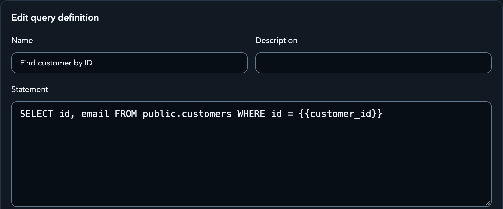
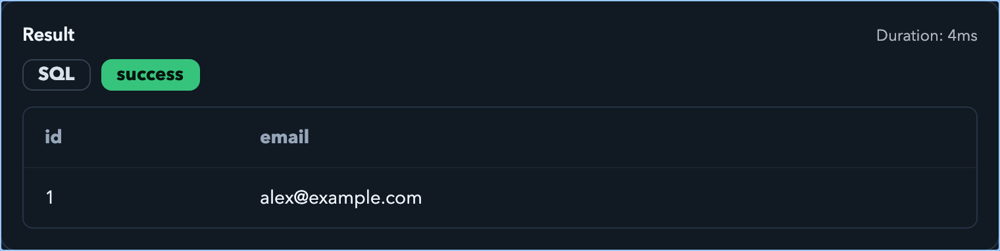

# Get your first result in the UI

Run a saved read and check its **success** badge and result. The PostgreSQL
example returns one synthetic row with ID `1` and email `alex@example.com`.
It creates no tables and reads no stored customer data.

You need a Braidplane workspace where you can create data sources and queries,
one system your deployment can reach, and least-privilege credentials for that
system. A project, Git repository, and destination are only needed for later
workflows. For another system, use the safe read in its
[connector guide](../connectors/index.md).

Hosted execution blocks loopback and private network addresses by default.
Keep TLS verification enabled. If you have no reachable system, use the
[reading tour](overview.md) to inspect an example pipeline and run.

## 1. Connect your system

1. Sign in, select your workspace, and open **Data Sources**.
2. Select **Add Data Source** and choose the connector.
3. Enter the settings from its guide and give the connection a recognizable
   name.
4. Follow the connector guide's authentication sequence.
5. For static credentials, select **Test connection**.

### Optional: try one failed connection and recover

Before saving a draft connection to a test database you control, replace only
**Database** with a name you know is absent, such as
`braidplane_tutorial_missing`. Select **Test connection**. The form reports
**Connection test failed** without identifying the database field. Check
**Database** against the name of the database you intended to use. Restore the
correct name and test again. The form should report **Connection successful**.

If the corrected name still fails, follow the test message and the
[PostgreSQL connection guide](../connectors/postgresql.md#authentication-and-permissions).

### Save the connection

For static credentials, select **Create data source** after the test succeeds.
OAuth and workload-identity connectors can save an inactive data source first.
Complete the connector's connection or verification step, then test.

The detail page shows whether the data source is active and its last test.
Stored credentials are never displayed again.

## 2. Save one read

Braidplane calls these saved reads **queries**.

1. Open **Queries** and select the data source you created.
2. Select **New query**.
3. Give the query a name you’ll recognize later.
4. For PostgreSQL, paste the SQL below into **Statement**. Select **+ Add param**,
   name it `customer_id`, and set its type to **integer** and its status to
   **required**. For another connector, use its guide's read example.
5. Set the row limit to `10` and timeout to `10` seconds. Select **Save query**.

```sql
SELECT id, email
FROM (VALUES (1, 'alex@example.com')) AS customers(id, email)
WHERE id = {{customer_id}}
```

[](images/saved-customer-read.png)

*The screenshot shows the same lookup against a table. Use the SQL above
to supply the sample row inline. Leave `{{customer_id}}` in the SQL and enter
its value when you run the query.*

## 3. Run and verify

Open your saved query. For the sample, enter `1` for `customer_id` and select
**Run query**. Look for the **success** badge and the row below. If you used
another connector, compare the result with the read example in its guide.

[](images/customer-read-result.png)

*The result shows ID `1` and email `alex@example.com`. Click either screenshot to
see it full size.*

The dashboard marks **Get a result** complete when a retained successful saved
operation is recorded. Its query link returns to that operation. **Hide** keeps
the product available; **Resume setup** restores the guidance. Connection and
query work do not require a project. Project and repository setup follows when
you are ready to build a repeatable pipeline.

Setup progress uses retained execution metadata without storing result payloads.
It tracks standalone reads separately from pipeline runs.

## 4. Repeat the read as a pipeline

Keep the saved query and connection if you want to repeat this read.

1. On the saved query, select **Build pipeline**. Select a project, or create
   one using the link and return to **Check readiness**.
2. If the project needs a repository, follow its repository setup link. Choose
   an existing repository or explicitly consent to creating a private GitHub or
   GitLab repository in your account or organization. Complete provider consent
   as the same Braidplane user, then return and check readiness.
3. Name the pipeline, supply any required query parameters, and select
   **Propose pipeline**. This references the current saved operation; it does
   not copy a previous execution or its parameter values.
4. Open **Review Git proposal** and review and merge it in your provider.
   Return to progress and select **Sync merged pipeline**. Git review and merge
   remain separate from deployment.
5. Once the exact proposed version is imported, select an enabled runtime
   target and **Configure source bindings**. Bind `source` to the connection
   containing your saved query, then return and **Deploy this version**.
6. Open the pipeline, then **Open Builder** for the same target. Select **Run**
   and inspect the resulting run's status, executed version and timeline.
   Wait for the run to finish and check its result.

To resume after leaving, open **Pipelines → Creation proposals** in the same
project. A failed proposal can retry its recorded definition. A changed
definition or repository needs a new pipeline name or slug. Declining provider
consent preserves the repository setup; **Resume setup** starts fresh consent.
If an action is unavailable, ask an administrator for the permission identified
on that screen.

## Clean up

For standalone resources, delete the saved query before deleting the data source.
If you continued into pipeline setup, keep them while the pipeline references
them. Remove any local credential material you created for the connection.

For the equivalent terminal workflow, [use the CLI guide](first-result-cli.md).
To add a destination, read the
[pipeline specification reference](pipeline-specifications.md), or follow the
[PostgreSQL-to-S3 example](first-pipeline.md).
