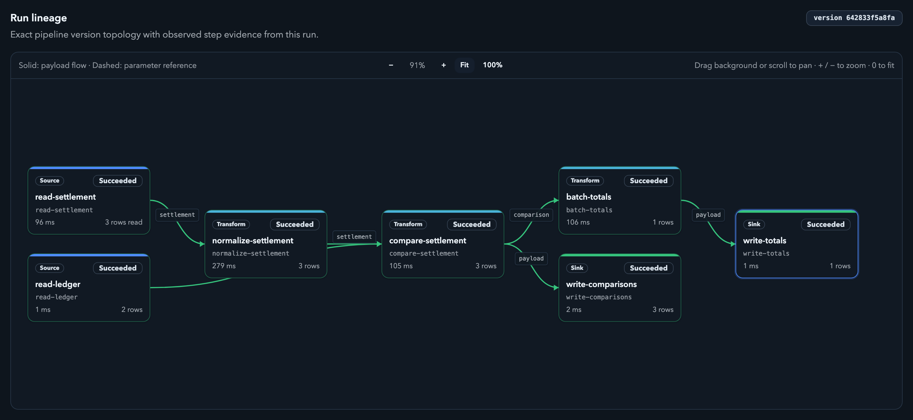

# How Braidplane works

Follow an example that joins orders with customers and writes the result to
another system. Choose a route based on what you have.

| What you have | What you can do |
|---|---|
| A browser | Read this tour and inspect an example run timeline. You need no account, installation, or provider credentials. This route runs no queries or pipelines. |
| A Braidplane workspace and one system it can reach | Run one saved read in the [UI](first-result.md) or [CLI](first-result-cli.md). The read needs no project, Git repository, or destination. |
| A workspace, PostgreSQL, a private S3 bucket, and a writable Git repository | Follow the [PostgreSQL-to-S3 walkthrough](first-pipeline.md) and compare the object in your bucket with the expected three rows. |

## 1. Choose the systems involved

A **connector** describes how Braidplane talks to a kind of system, such as a
database, HTTP API, CRM, or file store. A **data source** is one configured
connection to a specific system. Despite the name, a data source can also be
a destination when its connector and permissions allow writes.

For our example, identify where orders and customers live and where the result
should go. These choices determine which connectors and operations to use;
PostgreSQL and S3 are not platform requirements.

[Explore the connector capabilities](../connectors/index.md) before choosing
systems when you are ready to build a workflow.

## 2. Describe the work

A **pipeline** connects explicit steps:

```text
Read orders ─────┐
                 ├─ Join and select fields ─ Send the result
Read customers ──┘
```

A source operation specifies which records or files to read. A transform
specifies how to combine or reshape compatible inputs. A sink operation
specifies the write to perform. For example, an SQL transform can join
row-shaped order and customer inputs by customer ID.

Data contracts define the shapes expected between steps. The
[sample specification](files/joined-orders.pipeline.yaml) declares
`net_total_cents` as a required integer in the join's output.
Static validation checks that the SQL projects this required field. During
execution Core checks the resulting rows against the output contract before
passing them to the sink. See [contracts](pipeline-specifications.md#contracts).

Pipeline definitions are versioned through Git. Credentials belong to the
configured connections, outside the pipeline definition.

## 3. Organize the workflow

An **organization** owns the connections and controls who can access them.
A **project** groups related pipelines. A **project environment** binds the
pipeline's logical connection names to saved data sources.

For example, the pipeline can refer to `orders` while a development environment
maps that name to a connection containing synthetic orders. Another environment
can have its own binding. The definition can stay the same while the selected
connections differ.

## 4. Validate and deploy a version

Validation checks the pipeline structure, bindings and cached metadata before
execution. Refresh schemas separately when a connected system changes.

A **deployment** selects an immutable pipeline version for a project
environment. This makes the version and connection bindings explicit before
execution.

## 5. Run and inspect

A **run** executes the deployed workflow. Inspect its status, step timeline, and
failure diagnostics to understand what completed and where execution stopped.
If a step fails, inspect its diagnostics before deciding whether to retry;
write and replay behavior depends on the connector and operation.

Open the timeline below to see what a completed run looks like. This screenshot
shows a settlement example. In your own run, check each step and compare the
destination records with the expected result.

[](images/product-run-lineage.png)

## Where to go next

- [Review a pipeline change with Proof](proof.md) to assess an exact Git change before applying it.
- [Pipeline specifications](pipeline-specifications.md): learn the file format, steps, references, contracts, and validation commands.
- [Connector guide](../connectors/index.md): choose systems and understand capabilities.
- [Connect a system](../connectors/connect-a-system.md): learn the shared setup flow.
- [API reference](../api/index.md): explore the API contract.
