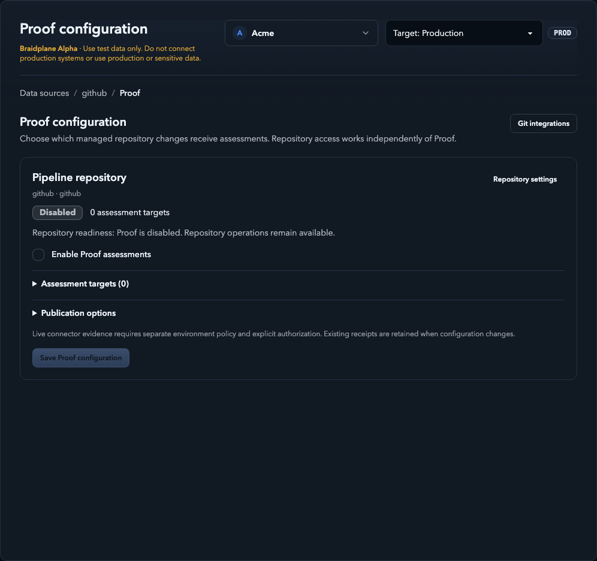
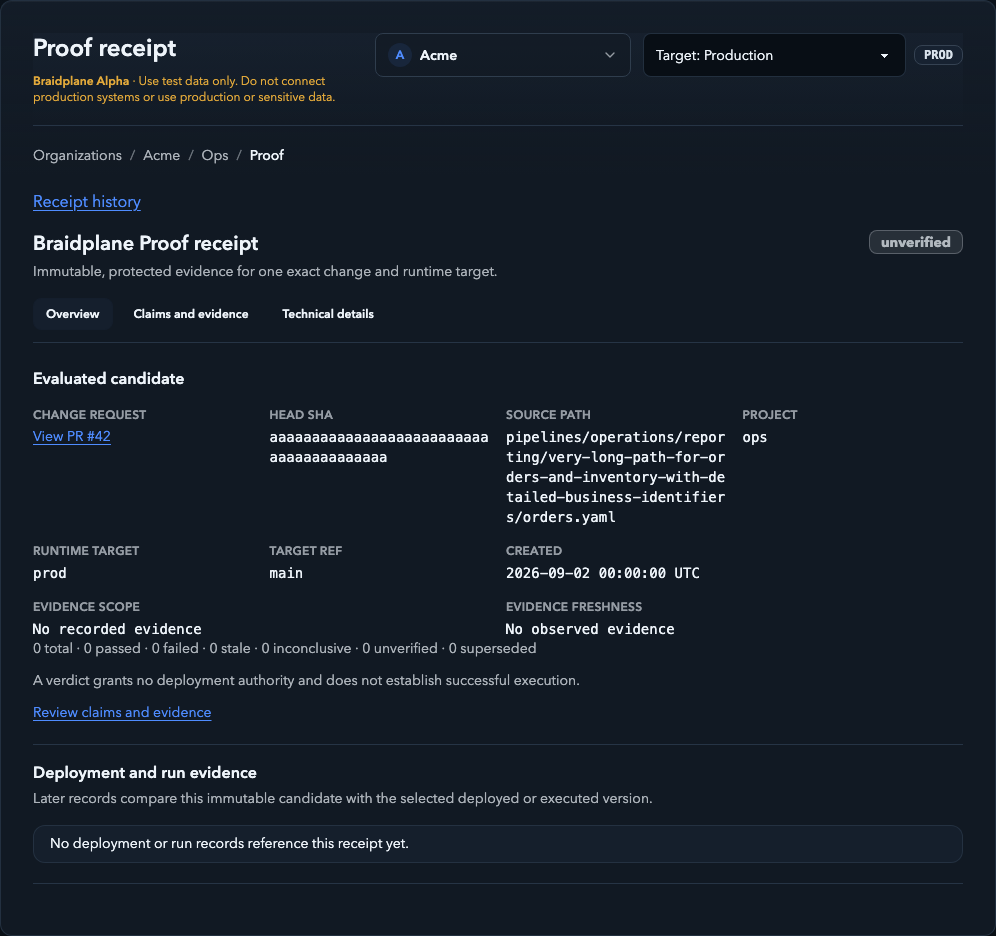
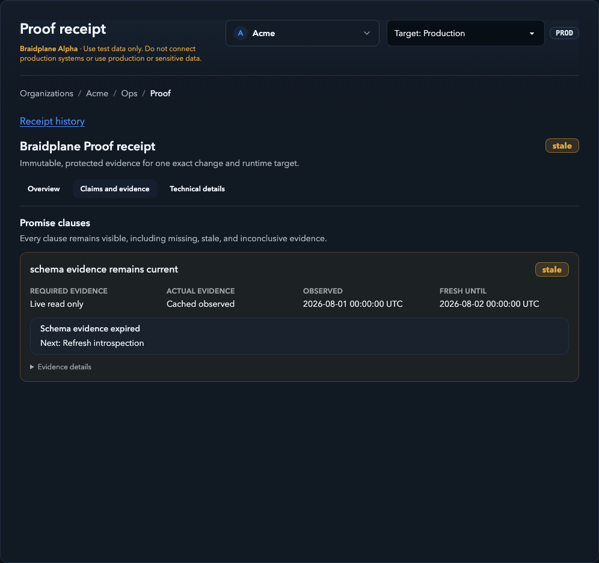

# Review a pipeline change with Proof

Before applying a pipeline change, you may want to know which parts of its
definition Braidplane can verify and which still need attention. Proof records
that assessment for one exact Git commit and one project/environment target.
Its receipt lets you inspect the evidence behind each result.

You can read this guide without an account. Using Proof requires a Braidplane
workspace, a managed [GitHub](../connectors/github.md) or
[GitLab](../connectors/gitlab.md) repository, and permission to read the pipeline.

!!! warning "Alpha evaluation"
    A passed assessment establishes
    only the evaluated claims at their recorded evidence levels. It does not
    prove a successful pipeline run, provider write permission, or production
    readiness. Proof never authorizes a merge or deployment.

## What an assessment covers

A **candidate** is the pipeline definition at the exact head commit of a pull
request or merge request, evaluated against a configured project, environment,
target ref, and pipeline path. Changing the commit or target requires a new
assessment; an older result cannot stand in for the new change.

A **claim** is one part of the pipeline's declared behavior that Braidplane
evaluates, such as a binding, capability, or field/type requirement. Each claim
records the evidence it requires, the evidence actually available, its verdict,
and any diagnostic or next action. The overall verdict summarizes these claims;
always inspect gaps before deciding what to do.

A **receipt** captures the candidate, target, claims, and evidence at assessment
time. Captured content is immutable. New evidence creates a new receipt; reads
can show that an old result is stale or superseded without rewriting it.
Receipts are protected workspace resources, even when a Git result links to one.

## Configure assessments

Ordinary repository access works independently of Proof. An administrator with
data-source and pipeline management permissions can enable assessments:

1. Connect a managed GitHub or GitLab data source and configure the project's
   Git backend for that repository.
2. Open **Git integrations → Proof assessments** in organization settings and
   choose **Configure Proof**. You can also open **Proof configuration** on the
   Git data source.
3. Check repository readiness. Open **Assessment targets**, then enter the
   repository-relative pipeline paths for the intended project/environment
   targets. Leave unused targets empty; each selected target must match the
   project's configured repository and tracked ref.
4. Select **Enable Proof assessments**. In **Publication options**, optionally
   select informational GitHub checks or GitLab notes.
5. Save the configuration. Resolve setup warnings before expecting assessments.
   GitLab webhook setup may require an authorized provider connection with
   webhook-management permission; use the offered retry after repairing access.

*Synthetic local UI example, captured 6 October 2026. Proof is disabled in this
example; no provider connection or observation was performed.*

Assessment enablement, Git publication, and live connector evidence are separate
controls. Live evidence needs deployment enablement, an environment policy,
and explicit authorization. Enabling assessments or reading a receipt does
not authorize or start a live observation.

Disabling Proof stops new assessments and publication while leaving ordinary
repository operations available. Changing the repository disables Proof and
retires its targets; reload and configure the new repository explicitly.
Existing receipts remain subject to access and retention rules.
[Generic Git](../connectors/git.md) does not provide managed provider Proof intake.

## Read a receipt

1. Select the project and environment, then open **Proof** in project navigation.
   History lists changes, pipeline paths, targets, verdicts, and freshness.
   Receipts can exist before any deployment or run.
2. Open the relevant history entry. In **Overview**, confirm the evaluated head
   commit, source path, runtime target, and target ref. Check the verdict,
   recorded evidence scope, freshness, and any supersession warning.
3. Open **Claims and evidence** to compare required and actual evidence for
   each claim. Read diagnostics and remediation; expand **Evidence details**
   only when more detail is useful.
4. Use **Technical details** for captured receipt/repository identity,
   fingerprints, compiler/policy versions, retention, and lifecycle provenance.
   A deployment or run link does not upgrade the receipt's evidence.
   Linking a deployment requires the same tenant and target, source path/ref,
   canonical specification, bindings and capabilities, and the receipt head SHA
   must equal the immutable pipeline version's Git commit. A different merge or
   squash commit cannot inherit the source-head receipt.
5. Use **Receipt history** to return to the same scoped page. Changing the
   environment opens that environment's history instead of changing an existing
   receipt's target. Refresh and browser Back retain the selected receipt section.

*Synthetic local UI example, captured 6 October 2026. Names, paths, commits,
dates, and the target named `prod` are fixture values, not production resources.
No deployment, run, or live observation is demonstrated.*

## Understand evidence and results

The evidence a claim **requires** may be stronger than the evidence actually
recorded. Required live evidence is not proof that a live check happened.

| Recorded evidence | What it establishes |
|---|---|
| Static (metadata only) | Evaluation of authored/compiled material without a fresh provider call. |
| Cached observed | A previously observed provider fact, with observation and expiry times. |
| Live read-only | A fresh, explicitly authorized provider metadata observation within its approved scope. |
| No observed evidence | There is no recorded provider observation supporting the claim. |

Bounded execution is a separate evidence level, outside the demonstrated Alpha
scope described here. Proof in this guide does not execute pipelines.

| Result | Meaning and next step |
|---|---|
| `passed` | Available evidence meets the claim's required level and supports it. Check scope and freshness; this is not permission to deploy. |
| `failed` | Evidence disproves the evaluated clause. Read its diagnostic and correct the relevant definition or binding. |
| `unverified` | Evidence is missing or the capability is unsupported. Identify the gap; retrying cannot add unsupported capability. |
| `inconclusive` | Evidence cannot decide the claim, for example because access was denied, a provider was unavailable, or a limit was reached. Resolve the diagnostic before a newly authorized assessment. |
| `stale` | Evidence has expired or is no longer valid. Arrange fresh evidence through the authorized path and inspect the new receipt. |
| `superseded` | A later receipt replaces this result. Open the result for the current candidate/evidence; keep the old receipt only as history. |

*Synthetic local UI example, captured 6 October 2026. The expired dates are
deliberate fixture values. This illustrates a gap between required and actual
evidence, not a live provider check.*

An overall result can contain several kinds of gaps. A failed validation clause
does not establish that every other promise failed; inspect each clause's result.
Unsupported and denied evidence never silently becomes passed.

## Demonstrated Alpha connector scope

Controlled hosted acceptance has demonstrated the
[HubSpot](../connectors/hubspot.md)/[BigQuery](../connectors/bigquery.md) pair with
explicitly authorized, read-only metadata observations:

- HubSpot verifies the account identity and contact-property metadata. It does
  not read contact records, search CRM data, discover custom objects, or write.
- BigQuery verifies one selected table's identity and metadata. It does not
  run discovery, read table rows, start query jobs, or insert data.

This does not establish provider write permission or successful sink writes.
Other connector capabilities and ordinary pipeline operations do not inherit
live Proof support from these observations. Live observations may be disabled
on a deployment; ask your workspace operator about availability and policy.

## Follow the Git result

When publication is enabled and provider setup is ready, GitHub receives an
**informational Proof check** on the exact evaluated PR head commit. The check
contains a sanitized summary and a link to the protected receipt. Its neutral
conclusion is informational; read the Proof verdict rather than treating the
check conclusion as a passed assessment.

Accepted GitHub behavior includes refreshing the same check to a newer receipt,
idempotent retries without duplicate checks, and truthful stale/superseded
results. A changed head must get its own assessment rather than inheriting an
older result.

GitLab receives an **informational merge-request note** identifying the evaluated
head and linking to its protected receipt. Accepted GitLab behavior includes
exact-head publication, new-head supersession, idempotent retries, and protected
links. It is not a GitLab CI status or merge gate. Its hosted acceptance used
static receipts; it does not establish live HubSpot/BigQuery observation on GitLab.

Publication failure does not rewrite an immutable receipt. Inspect the workspace
receipt if the provider result is unavailable, and have an authorized operator
resolve publication setup or access. Neither provider result merges, applies,
deploys, or runs a pipeline.

## Access, retention, and sharing

Follow a receipt link while signed in to the correct workspace with pipeline-read
permission for its project/environment. A Git result does not make the receipt
public or grant workspace access. Signed-out readers are directed to sign in;
insufficient permissions or a removed receipt can prevent access.

Deleting a project erases its detailed Proof records. Pending or running Proof
does not prevent deletion; running work is cancelled and late results are
discarded. The project deletion remains in the audit history. Deleting a project
does not delete its organization data source.

Receipts have an effective retention limit of seven days; deletion can make an
old link unavailable. Captured receipt content stays immutable until deletion,
while freshness and supersession can change how it is presented.

Keep receipts and evidence details within the authorized workspace. Repository
identity, paths, schemas, and diagnostics can be sensitive even when credentials
and raw provider data are excluded. The screenshots in this guide use only
synthetic local fixtures; they contain no customer data or provider payloads.

For pipeline authoring and the separate apply/deploy/run workflow, see
[How Braidplane works](overview.md) and
[Pipeline specifications](pipeline-specifications.md).
